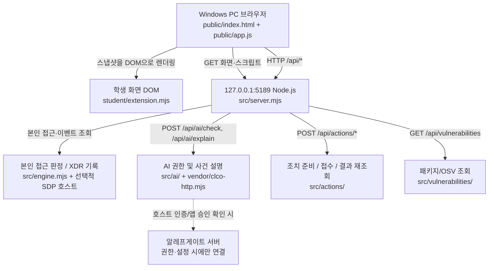

# hongbin — 학생 실행 설명서·시스템 구성도 (21단계)

> **근거:** 저장소 `https://github.com/hongbin9305/alekov-agent`의 현재 코드(`package.json`, `tools/start-alekov.ps1`, `src/server.mjs`, `public/app.js`, `student/extension.mjs`, `.env.example` 및 제공 문서)를 읽고 정리했다. 이 문서는 학생 작성 내용이며 제공 문서를 수정하거나 대체하지 않는다. **실제 사용자 PC 실행, 새 환경 재설치, 운영 SDP·알레프게이트·보안 조치·OSV 실조회는 미확인**이다. 공식 AI 코드 판정 역시 실환경 재현 성공을 의미하지 않는다.

## 1. 프로젝트 목적과 지원 환경

**hongbin**은 본인 로그인·기기·세션, 업무 앱 접근 판정, 본인 범위의 XDR·접속 기록, 알레프게이트 AI 연결·근거 기반 설명, AI 조치 제안과 실제 서버 처리 상태의 구분, 공개 패키지 OSV 취약점 조회 결과를 표시하는 학생용 보안 Agent다. 서버의 판정·보안 집행 권한을 학생 화면에 옮기지 않는다.

기본 시작 틀 이름은 **케셰브(KESHEV)**다. ALEPH에서 정한 개인 앱 이름 `hongbin`과 별도로, 기존 실행 스크립트와 콘솔 출력은 `케셰브`를 사용하므로 오류가 아니다.

| 항목 | 코드·제공 안내에서 확인한 계약 | 실제 환경 |
| --- | --- | --- |
| OS/셸 | Windows PowerShell, `tools/start-alekov.ps1` | 새 PC 실행 미확인 |
| Node.js | `package.json`의 `engines.node`: `24.19.0`; 시작 도구는 22~24 허용 | 현재 PC의 `node --version` 미확인 |
| npm | Node.js 패키지 실행기. `start`/`demo`/`check` 스크립트 있음 | `npm --version` 미확인 |
| Git | 공개 저장소 복제·커밋 확인용 | 새 PC의 `git --version` 미확인 |
| 앱 버전 | `package.json`의 `0.2.11` | 서버 진단 출력의 다른 버전과 혼동하지 않음 |
| 브라우저 | 로컬 `http://127.0.0.1:5189/` | 실제 브라우저 표시 미확인 |
| 의존성 | `package.json`에 npm `dependencies`/`devDependencies`가 없음 | 별도 패키지 설치·다운그레이드 불필요 |

이 공개 Git 커밋에 `on-client/package-lock.json` 파일은 **없다**. 따라서 설치된 패키지·lock 파일의 실제 OSV 대조를 완료했다고 주장하지 않는다. 운영자가 공개 조회 대상 프로젝트·허용 패키지를 준비하지 않았다면 `not_configured`나 `not_checked` 등의 상태로 남을 수 있으며 이는 "취약점 없음"이 아니다.

## 2. 작업 위치와 실제 폴더 구조

**Git 저장소 최상위는 `alekov-agent/`, 실행해야 할 앱 폴더는 `alekov-agent/on-client/`다.** 기존 ALEPH Workbench 프로젝트가 있으면 기존 `on-client`를 계속 사용하고 덮어쓰지 않는다. 사용자 드라이브/계정별 절대경로는 실제 PC에서 확인해야 하므로 임의로 단정하지 않는다.

```text
alekov-agent/                     <- Git 최상위·커밋/제출
└── on-client/                    <- PowerShell 실행 위치
    ├── README.md                <- 제공 README + 학생 설명서 링크
    ├── package.json             <- 버전 및 npm 스크립트
    ├── .env.example             <- 비밀 없는 설정 견본
    ├── public/
    │   ├── index.html          <- 제공 화면/버튼
    │   ├── app.js              <- 제공 API 요청, 렌더링, 취소·갱신
    │   └── vulnerabilities-view.mjs
    ├── student/
    │   ├── extension.mjs        <- 학생 작성 render* 함수
    │   └── engine-adapter.mjs   <- 기존 호스트 어댑터
    ├── src/
    │   ├── server.mjs          <- Node.js 로컬 HTTP 서버
    │   ├── engine.mjs          <- disconnected/demo 또는 호스트 엔진
    │   ├── engine/             <- SDP 연결(설정 시)
    │   ├── ai/                 <- AI 권한·설명 서비스
    │   ├── actions/            <- 조치 준비·접수·결과 경계
    │   └── vulnerabilities/    <- 잠금 파일/OSV 스캐너
    ├── vendor/
    │   └── clco-http.mjs       <- 게이트웨이 HTTP 전송
    ├── tools/
    │   └── start-alekov.ps1    <- 기본 실행·포트 점검
    └── docs/
        ├── STUDENT_RUNBOOK.md   <- 학생 작성 본 문서
        ├── STUDENT_LAUNCH_GUIDE.md
        ├── CONNECTION_TROUBLESHOOT.md
        ├── AI_SETUP_GUIDE.md
        ├── SDP_HOST_CONNECTION.md
        └── STUDENT_PROMPTS.md
```

## 3. 실제 입력할 실행·종료·다시 실행 순서

### 3.1 기존 프로젝트에서 시작

Windows 파일 탐색기로 **자신의 프로젝트 `on-client` 폴더**를 열고 주소창에 `powershell`을 입력한다. 새 PowerShell에서 다음을 먼저 확인한다.

```powershell
Get-Location
Test-Path .\package.json
Test-Path .\tools\start-alekov.ps1
node --version
npm --version
git --version
```

`Test-Path` 두 값은 `True`여야 하며, Node.js는 22~24 범위(교육 기준 `v24.19.0`)여야 한다. **이 문서 작성 과정에서는 위 명령을 사용자 PC에서 실행하지 않았으며 실제 버전 출력은 미확인**이다.

같은 `on-client` 폴더에서 시작한다.

```powershell
powershell -NoProfile -ExecutionPolicy Bypass -File .\tools\start-alekov.ps1
```

제공 스크립트의 **정상 시작 신호**는 아래 두 문장이다(원문 대조 결과, 실제 PC에서 출력 확인한 기록은 아님).

```text
케셰브가 켜졌습니다. 브라우저에서 http://127.0.0.1:5189/ 을 여세요.
서버가 응답한 것만 확인했습니다. AI 연결 상태는 화면에서 따로 확인해 주세요.
```

브라우저에서 `http://127.0.0.1:5189/`를 연다. 화면의 **보호 현황**이 표시되어도, 이것은 앱 서버가 시작됐다는 뜻이지 실제 SDP·AI·보안 조치 연결 성공을 입증하지 않는다.

- **종료:** 시작 명령을 실행한 PowerShell에서 `Ctrl+C`. 기존 데이터·파일·Git 기록 삭제 불필요.
- **재실행:** 같은 `on-client` 폴더의 PowerShell에서 위 명령을 다시 실행.
- **포트 5189 사용 중:** 다른 프로세스를 종료하지 않고 `powershell -NoProfile -ExecutionPolicy Bypass -File .\tools\start-alekov.ps1 -Port 5190` 실행. 브라우저 주소도 `http://127.0.0.1:5190/`로 변경.
- **`-ExecutionPolicy Bypass`:** 해당 실행에만 적용하며 Windows 전체 실행 정책을 영구 변경하지 않음.
- **`-Background`:** 시작 도구가 출력한 PID의 `node`만 작업 관리자에서 종료(제공 문서 절차).

문법만 확인하려면 앱 폴더에서 `npm run check`를 쓴다. 이 명령은 `node --check student/extension.mjs`이며 인증·서버 연결·기능 검증이 아니다. `npm start`는 `node src/server.mjs`, `npm run demo`는 `node src/server.mjs --demo`다. `demo`의 합성 사건·접근 판정은 실제 사용 기록이 아니다. 기본 실행에는 별도 호스트 자격이 없어 **`disconnected`**가 기본이다.

### 3.2 새 빈 폴더에서 공개 저장소 받기(재현 절차, 미실행)

기존 프로젝트 폴더를 덮어쓰지 말고, 공개 소스를 새 위치로 받는 사람만 아래 명령을 사용한다. Node.js가 없으면 공식 `https://nodejs.org/`에서 22~24를 설치한 뒤 새 셸을 열고 진행한다.

```powershell
git clone https://github.com/hongbin9305/alekov-agent.git
Set-Location .\alekov-agent\on-client
node --version
powershell -NoProfile -ExecutionPolicy Bypass -File .\tools\start-alekov.ps1
```

**이 새 환경 복제·실행은 지금 수행하지 않았으므로 미확인이다.** `npm install`을 임의로 실행하거나 패키지를 취약하게 낮추지 않는다.

## 4. 시스템 구성도 — Mermaid + 문장 설명



**구성도 텍스트 설명:** 브라우저는 `src/server.mjs`가 로컬 `127.0.0.1:5189`에서 제공한 `public/index.html`·`public/app.js`를 읽고, `/api/me`·`/api/apps`·`/api/events` 등으로 상태를 요청한다. 제공 화면은 `student/extension.mjs`의 `render*`에 현재 스냅샷을 전달하고, 학생 함수는 요청을 직접 보내지 않고 DOM을 만든다. 접근 제어·XDR의 데이터는 `src/engine.mjs`와 승인된 SDP 호스트를 통해서만 현재 사용자 범위로 조회한다. AI 사건 설명은 `/api/ai/explain` → `src/ai/` → `vendor/clco-http.mjs` → AI 게이트웨이로 이어지며 **설정과 권한이 없으면 실제 호출 성공이 아니다**. 조치 요청과 결과 확인은 제공 서버의 `/api/actions/*` 경로가 맡고, 학생 함수는 ACK·미실행·효과 관측을 구분해 보여 준다. 공개 패키지 취약점은 `/api/vulnerabilities`가 제공 스캐너를 통해 조회하되, 담당자 승인 대상만 외부 OSV로 조회한다.

공개 주소: [GitHub 저장소](https://github.com/hongbin9305/alekov-agent), [ALEPH 포털](https://aleph-omega.vercel.app). `127.0.0.1`은 **개인 PC 내부 주소**이지 공개 배포 주소가 아니다. 운영 인증·프로젝트 식별 정보나 개인 호스트 설정값은 문서·커밋·화면에 기록하지 않는다.

## 5. 제공 파일과 학생이 구현한 함수의 역할

| 경계 | 파일·함수 | 내용과 제한 |
| --- | --- | --- |
| 제공 화면 | `public/index.html`, `public/app.js` | 버튼·HTTP 요청·상태 저장·취소·세대 비교·늦은 응답 무효 처리. 학생은 수정하지 않음 |
| 제공 앱 서버 | `src/server.mjs`, `src/engine.mjs` | 로컬 HTTP 경로·기본 미연결 또는 예제 엔진 |
| 제공 연결/조회 | `src/ai/`, `vendor/clco-http.mjs`, `src/actions/`, `src/vulnerabilities/` | AI 앱 승인/요청, 서버 조치 계약, 승인된 OSV 조회. 운영 권한 없이 성공 보장 없음 |
| 학생 표시 | `student/extension.mjs` | 제공 화면에서 전달받은 데이터만 텍스트 DOM으로 렌더링. HTTP 전송·비밀값·보안 집행 없음 |

| 학생 함수 | 실제 코드가 구분하는 상태 |
| --- | --- |
| `renderIdentity` | 계정·기기·세션과 unknown |
| `renderDecision` | 업무 앱 접근 허용·거부·추가 확인·확인 불가 |
| `renderEvents` | 접속·XDR 이벤트, 근거 ID·규칙·현재 상태 |
| `renderStatus` | 오류·빈 목록·재시도·미지원 조치·도움정보 |
| `renderAiConnection` | 알레프게이트 모델 목록 점검과 권한/한도/취소/실패. 실제 사건 설명과 구분 |
| `renderExplanation` | 같은 사건의 근거·규칙·unknown과 미집행 AI 제안; 근거가 어긋나면 거부 |
| `renderAction` | 제안·준비·사람 확인·서버 전달·접수(ACK)·효과 관측 분리. `succeeded`에 `observation.effectApplied === true`가 필요 |
| `renderVulnerabilities` | 설치된 정확한 버전·OSV ID/modified·조회 시각·`complete`/`partial`/미조회/`unverifiable` 구분 |

`student/engine-adapter.mjs`는 제공된 호스트의 허용된 본인 범위 기능만 연결하는 경계다. 비밀·집행 권한을 학생 화면에 추가하지 않는다. `.env.example`은 비밀 없는 견본이며 운영 개인 자격은 담당자의 별도 설정이 필요하다. `package-lock.json`의 실제 원본이 없는 상태에서 임의의 OSV 조회 성공 결과를 만들지 않는다.

## 6. 장애 증상 → 확인 → 복구 (실제 소스 기준)

| 증상·코드 | 확인 대상 | 안전한 처리 |
| --- | --- | --- |
| 시작 `Node.js 가 없습니다` 또는 버전 오류 | `node --version`, `package.json`의 지원 범위 | 지원 Node.js 설치/변경 후 새 PowerShell에서 시작 |
| 시작 `포트 5189 를 다른 프로그램이 쓰고 있습니다` | 기존 포트 사용자 | 다른 프로세스 강제 종료 금지; 시작 도구 `-Port 5190` |
| `앱 폴더가 아닙니다` / `시작 틀 폴더가 아닙니다` | `Get-Location`, `.\package.json`, `.\tools\start-alekov.ps1` | 실제 `on-client` 폴더로 이동. 프로젝트 초기화·덮어쓰기 금지 |
| 서버 `…초 안에 뜨지 않았습니다` | PowerShell 원문 오류·포트·Node | 강사에게 오류/도움정보 전달, 실행 성공으로 주장하지 않음 |
| `ENGINE_NOT_CONNECTED` / `disconnected` | SDP 호스트 활성 설정 유무 | 기본 미연결로 표시. 실제 SDP 연결은 운영자 안내 사용 |
| `NATIVE_HOST_DISABLED` | native 호스트 설정이 유효하게 연결됐는지 | 운영자에게 설정 발급/경로 안내 문의; 열쇠/토큰 복사 금지 |
| `ON_AI_PROVISIONING_PENDING` | 계정 연결·앱 승인·권한 준비 | `연결 도움정보 보기` 확인 후 담당자에게 요청; 성공 표기 금지 |
| `WB_CLCO_AUTH_REQUIRED` / `WB_CLCO_ACCESS_BLOCKED` | 앱 인증·접근 권한 | 담당자와 승인 상태 확인, Workbench 열쇠 재사용 금지 |
| `WB_CLCO_TIMEOUT` / `WB_CLCO_RATE_LIMITED` | AI 시간 초과/요청 제한 | 자동·유료 반복 요청 금지, 원인 확인 후 사용자 수동 재점검 |
| `CONTRACT_MISMATCH` / `ENGINE_RESULT_UNVERIFIED` | 응답 형식·시각·본인 범위 확인 여부 | 확인 불가 유지, 필요하면 제공 화면에서 수동 재조회 |
| `ACTION_UNSUPPORTED` | SDP 조치 지원 여부 | 학생 집행 버튼 추가 금지; 현재 지원 안 됨 표시 |
| 조치 `pending` / `unknown` | 현재 requestId/receipt와 effectApplied 관측 | ACK는 성공 아님; 제공 `원천 결과만 재조회`로 현재 요청만 확인 |
| `not_configured` / `not_checked` | 운영자가 승인한 공개 패키지 조회 목록 | 미설정·미조회 표시; 취약점 없음으로 변경하지 않음 |
| OSV `partial` / `unverifiable` | 성공한 패키지의 취약점 ID 및 실패한 조회 | 기존 ID 유지, 실패 항목은 확인 불가, 임의 버전 강등 금지 |
| 조회 `CANCELLED` / `TIMEOUT` | 취소·시간 제한과 새로고침 | 이전 표를 현재 결과처럼 표시하지 않고 필요 시 직접 재조회 |

화면의 **`도움정보 불러오기`**, **`확인했으며 복사합니다`**, **`연결 도움정보 보기`**, **`현재 API 연결 점검`**, **`설치 패키지 조회`**는 제공 `index.html`/`app.js`에 실제 있는 버튼이다. 추가 장애·권한 분류는 [제공 장애 안내](CONNECTION_TROUBLESHOOT.md), [앱 시작 안내](STUDENT_LAUNCH_GUIDE.md), [AI 설정 안내](AI_SETUP_GUIDE.md)를 참조한다.

## 7. 확인한 것과 미확인 항목·직접 재현 순서

| 항목 | 이 문서 작성 시 코드로 확인 | 실제 실행 결과 |
| --- | --- | --- |
| 경로·버전 | Git 폴더 목록, `package.json`, 시작 스크립트 | 사용자 PC `node --version`/`npm --version` 출력은 **미확인** |
| 시작·종료·포트 | `start-alekov.ps1`의 명령·메시지·`-Port`/`Ctrl+C` 안내 | 새 PowerShell 및 브라우저 실제 시작·종료는 **미확인** |
| 상태/화면 경계 | 학생 `render*`, 제공 `app.js` 요청/취소 원문 | 실제 개인 PC 표시/키보드 접근은 **미확인** |
| 실제 SDP·AI | `engine.mjs` 및 `src/ai/`의 서버 경로 | 학생 계정·승인·실제 AI 응답은 **미확인** |
| 조치·OSV | `src/actions/`, `src/vulnerabilities/`와 학생 표시 함수 | 보안 집행·효과 관측·실제 설치 버전 OSV 조회 **미확인** |

**직접 확인 1:** 기존 작업을 보존한 채 `on-client`에서 새 PowerShell을 열어 3장의 읽기 전용 명령으로 경로·버전을 확인하고, 시작 스크립트를 실행해 실제 콘솔 신호와 브라우저 `보호 현황`을 확인한 후 `Ctrl+C`로 종료한다.

**직접 확인 2:** 경로·버튼 이름을 실제 PC 화면과 비교하고, 허용된 조회 버튼만 필요한 때 직접 누른다. 실제 유료 AI 요청이나 보안 집행을 시험 목적으로 반복하지 않는다. 새 환경에서 실행하지 않은 것은 **미확인**으로 적는다.

## 8. 21단계 커밋·공식 제출 절차

21·22단계는 **ALEPH 4차 방어전 화면에 GitHub 저장소 주소와 커밋 40자리를 직접 입력**한다. 현재 Workbench의 `포털 제출 준비`는 13~20단계만 지원한다. 공개 저장소이므로 비공개 원문 JSON은 필요하지 않다. 비공개 프로젝트만 공식 `비공개 저장소 원문 준비 방법`을 따른다.

- 저장소 주소: `https://github.com/hongbin9305/alekov-agent`
- 커밋: **현재 21단계 README와 이 문서가 함께 포함된, 실제 GitHub 커밋 SHA 40자리**를 확인해서 입력한다.
- 포털 판정은 커밋 원문을 AI가 **읽고 대조**하는 것으로, 실제 실행/계정 연결을 대신하거나 21단계 통과를 보장하지 않는다.

관련 제공 문서: [처음 시작](GETTING_STARTED_STUDENT.md), [실행](STUDENT_LAUNCH_GUIDE.md), [장애](CONNECTION_TROUBLESHOOT.md), [AI](AI_SETUP_GUIDE.md), [SDP](SDP_HOST_CONNECTION.md), [학습 계약](STUDENT_PROMPTS.md).
